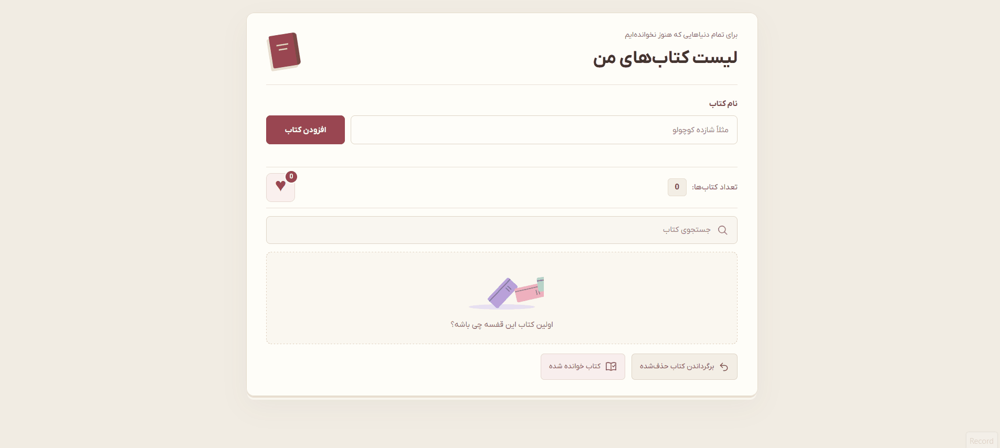
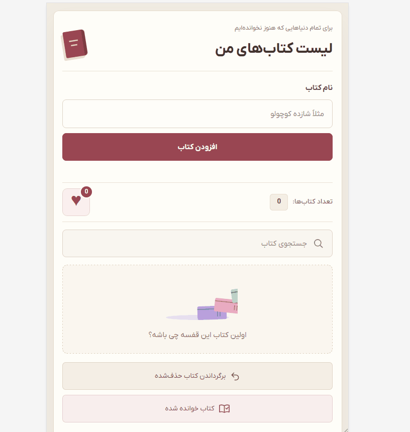

# 📚 My Book List

A responsive personal book list built with **HTML, CSS, and Vanilla JavaScript**, with a Persian interface and right-to-left layout.

Add books, edit their titles, track your reading status, and keep your favorites together.

## 🔗 Live Demo


[View Live Demo](https://anahita-valipour.github.io/library-list-js/)

> Replace the URL above with your project's GitHub Pages address.

## 🎬 Preview

| Desktop | Mobile |
| :---: | :---: |
|  |  |

## ✨ Features

### Book Management

- **Add books** by entering a title.
- **Validate titles** to prevent empty or whitespace-only entries.
- **Edit titles** using the same input and add button.
- **Delete books** from the list.
- **Undo deletions** one at a time, starting with the most recently deleted book.
- Restore a deleted book with its previous **reading and favorite status**.
- Display the **total number of books**, updated after adding, deleting, or restoring a book.

### Search & Reading Status

- **Search as you type** for titles containing the entered text.
- Search ignores letter case and trims spaces at the beginning and end of the query.
- Toggle each book between **read and unread**.
- Apply a line-through style to read book titles.
- **Show only read books** using the reading filter.
- Click the reading filter again to **show all books**.

### Favorites

- Mark a book as a favorite by turning its **heart red**.
- Remove a book from favorites by clicking its heart again.
- Open or close the **favorites panel** using the main heart button.
- Update the favorites panel and its counter when toggling a book's favorite status.

## 🎨 Design

- Responsive layouts for desktop, tablet, and mobile.
- Persian interface with right-to-left text direction.
- **IRANYekanX** typography.
- Warm cream and burgundy color palette.
- Icons for editing, deleting, undoing, and the reading filter.
- Animated books when the main list is empty.
- Reduced-motion support and visible keyboard focus styles.

## 🛠️ Technologies

- HTML5
- CSS3 — Grid, Flexbox, media queries, and pseudo-elements
- Vanilla JavaScript — DOM manipulation, events, arrays, and objects
- SVG icons and animation

## 📂 Project Structure

```text
book-list/
├── index.html
├── style.css
├── app.js
├── images/
│   ├── books.svg
│   └── books-still.svg
├── fonts/
│   ├── IRANYekanX-Regular.woff2
│   └── IRANYekanX-Bold.woff2
├── screenshots/
│   ├── desktop.gif
│   └── mobile.gif
└── README.md
```

## 🚀 How to Run

1. Download or clone the repository.
2. Open `index.html` in your browser, or use VS Code's Live Server extension.

No build step or package installation is required.

> The project uses IRANYekanX font files. Include or redistribute these files only as permitted by your font license.

## 🧠 Learning Goals

This practice project explores:

- Creating and removing DOM elements dynamically.
- Handling user actions with event listeners and event delegation.
- Storing book information in an array of objects.
- Connecting DOM elements to data using `data-*` attributes and IDs.
- Using `find()`, `filter()`, `some()`, `forEach()`, `push()`, and `pop()`.
- Managing editing, reading, and favorite states.
- Keeping book data and the visible interface in sync.

## 📌 Current Limitations

- Data is stored in memory and resets when the page reloads.
- Duplicate titles are allowed.
- Search and the reading filter work independently; using one can replace the other's visible results.
- Adding or restoring a book does not automatically reapply the current search or reading filter.
- Deleting or renaming a favorite book does not immediately refresh the favorites panel. Deleting a favorite also leaves its counter unchanged until a later favorite toggle or restore action refreshes it.

## 👩‍💻 Author

**Anahita Valipour**

[GitHub Profile](https://github.com/anahita-valipour)

## 📝 Project Purpose

Built to practice JavaScript problem solving, DOM manipulation, events, and managing application state without a framework.
